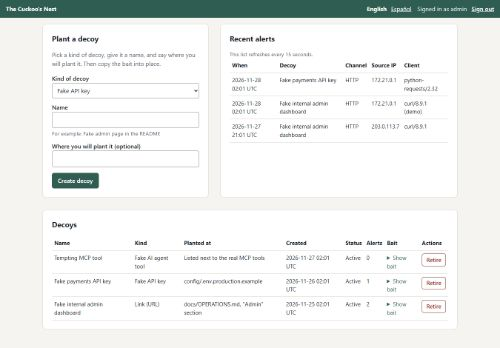
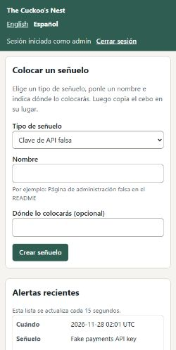

# The Cuckoo's Nest

[](https://github.com/RandyBauer/cuckoos-nest/actions/workflows/ci.yml)
[](https://github.com/RandyBauer/cuckoos-nest/actions/workflows/ci.yml)
[](https://github.com/RandyBauer/cuckoos-nest/actions/workflows/ci.yml)

Honeytokens that catch whoever touches them — AI agents included.

A honeytoken is a decoy: a link, a fake API key, or a fake tool that nobody has any reason to
touch. So any touch at all is an alarm. The name comes from Cliff Stoll's *The Cuckoo's Egg*,
where a fake set of files was the bait that caught a real intruder.

The Nest plants decoys where people and coding agents wander — docs, config files, and the tool
list an agent sees over the [Model Context Protocol](https://modelcontextprotocol.io) — and
records every touch.

> **Live:** https://54-186-140-252.sslip.io (AWS EC2 + RDS, deployed automatically from `main`).
> Roadmap: the [v1.0 milestone](https://github.com/RandyBauer/cuckoos-nest/milestone/1).

## How it works

Each **decoy type** is a plugin: one class that implements
[`DecoyType`](src/main/java/io/github/randybauer/cuckoosnest/decoy/DecoyType.java). The app finds
every plugin at startup, so adding a new kind of decoy doesn't change any other code.

The first plugin is the **URL decoy**. It is a link like `https://<nest>/t/<random token>` that
you plant in docs or code comments with a tempting label, such as "internal admin dashboard".
Any request to it, with any HTTP method, records an alert with the time, source IP, user agent,
and request details.

The tripwire always answers with the same plain `404 Not Found`, whether the token is a live
decoy, a retired one, or random text. A visitor can't tell which links are traps.

The second plugin is the **credential decoy**: a fake API key you plant in a config file, next to
the address of the Nest's decoy API:

```
API_BASE_URL=https://<nest>/api/v1
API_KEY=nest_k3Q9...
```

Any request under `/api/v1/` that sends the key (as `Authorization: Bearer`, an `X-API-Key`
header, or `?api_key=`) records an alert. The answer is always the same `401`. Keys look like
`nest_` + 30 random characters + a 6-character CRC32 checksum. The prefix keeps them from ever
looking like a real cloud key, and the checksum lets the Nest reject random strings without a
database lookup (the same idea GitHub uses for its tokens).

## Connect an AI agent (MCP)

The Nest is also a [Model Context Protocol](https://modelcontextprotocol.io) server at `/mcp`
(streamable HTTP). Agents authenticate with a bearer token from the `NEST_MCP_TOKEN` environment
variable. With the Docker stack running, add it to Claude Code like this:

```bash
claude mcp add --transport http cuckoos-nest http://localhost:8080/mcp   --header "Authorization: Bearer dev-mcp-token"
```

The agent gets five tools:

| Tool | What it does |
|---|---|
| `create_decoy` | Makes a URL, CREDENTIAL, or MCP_TOOL decoy and returns the bait to plant |
| `list_decoys` | Lists decoys with their bait |
| `list_alerts` | Lists recent touches |
| `explain_alert` | Explains one alert in plain language and suggests what to check |
| `retire_decoy` | Takes a decoy out of service |

The third decoy type lives here too. An **MCP_TOOL decoy** is a tempting fake tool, such as
`get_production_credentials`, listed next to the real tools. A well-behaved agent never needs it,
so a call means the agent was misled, for example by a prompt injection. The call records an alert
naming the agent's client, and returns a dull "permission denied".

## Dashboard

Sign in to plant decoys, copy their bait, retire them, and watch alerts arrive. The alert list
refreshes every 15 seconds.

| Desktop | Phone (Spanish) |
|---|---|
|  |  |

### Languages

Every word on every page comes from [`messages.properties`](src/main/resources/messages.properties)
(English) or [`messages_es.properties`](src/main/resources/messages_es.properties) (Spanish).
Nothing is hard-coded in the templates. Switch with the links in the header (`?lang=es`), and a
cookie remembers the choice. A test fails if the two files ever have different keys, or if a page
uses a key that doesn't exist.

### Accessibility and responsive design

The pages follow WCAG: real `<label>`s on every field, table captions and column headers, a skip
link, announced status messages (`role="status"`, `aria-live`), a visible focus outline, and colors
with AA contrast. Checked with Google Lighthouse's accessibility audit, which scores
**100/100** on every page:

| Page | Layout | Score | Report |
|---|---|---|---|
| Dashboard | Phone | 100 | [report](docs/accessibility/dashboard-mobile.report.html) |
| Dashboard | Desktop | 100 | [report](docs/accessibility/dashboard-desktop.report.html) |
| Dashboard, Spanish | Phone | 100 | [report](docs/accessibility/dashboard-es-mobile.report.html) |
| Sign in | Phone | 100 | [report](docs/accessibility/login-mobile.report.html) |

On narrow screens the layout drops to one column, and tables turn into labeled cards.

## How Redis is used

Redis does three jobs, each on the public alarm path. If Redis goes down, all three **fail open**:
the Nest keeps catching touches, because an alarm system must not lose alarms when its cache
breaks.

| Job | How | Why |
|---|---|---|
| "Not a decoy" cache | A miss is remembered for 10 minutes (`nest:miss:*`) | Scanners throw thousands of random tokens at `/t/` and `/api/v1/`. Repeats are answered from Redis instead of Postgres. Real decoys always come from Postgres, so they're never stale. |
| Collapse bursts | `SET NX` with a 60-second expiry per decoy and source (`nest:seen:*`) | A script hitting one decoy 500 times in a minute makes one alert, not 500. |
| Rate limit | `INCR` per IP per minute (`nest:rate:*`), 120 by default | The tripwires must be public, so a flood is answered with `429` before it reaches the database. Every tripwire gets the same `429`, so the limit can't be used to tell traps apart. |

## Architecture

[docs/ARCHITECTURE.md](docs/ARCHITECTURE.md) has Mermaid diagrams of the components, the decoy
plugin system, a decoy being touched, an AI agent calling a decoy tool, the data model, and the
deployment. A test fails the build if a class the diagrams name is renamed, or if a new
controller or service is missing from them. The reasons behind the main design choices are in
[eight short decision records](docs/adr/README.md).

## Tech stack

Java 21 · Spring Boot 4.2 · Spring AI MCP server · PostgreSQL · Redis · Gradle

## Build and run

You need **JDK 21** and **Docker** (the tests start real Postgres and Redis containers).

```bash
# Compile, run all tests, and run the checks
./gradlew build

# Start the app on http://localhost:8080 with throwaway Postgres and Redis containers
./gradlew bootTestRun
```

On Windows, use `gradlew.bat` instead of `./gradlew`.

Check that it is up:

```bash
curl http://localhost:8080/actuator/health
# {"status":"UP"}
```

## Run with Docker

The whole stack (the app, Postgres, and Redis) starts with one command:

```bash
docker compose up --build
```

The app is then at http://localhost:8080. Sign in with the dev-only login **admin /
nest-dev-password**; the dev MCP token is `dev-mcp-token`. The image is built by a multi-stage
[`Dockerfile`](Dockerfile): a JDK stage compiles the app, and a small JRE stage runs it as a
non-root user with a health check.

## Develop in a Dev Container

Open the folder in VS Code and run **Dev Containers: Reopen in Container**. The
[Dev Container](.devcontainer/devcontainer.json) gives you Java 21, Gradle, and Docker access for
Testcontainers, with Postgres and Redis running beside it. Ports 8080, 5432, and 6379 are
forwarded, and the first build is warmed up by `postCreateCommand`.

## Databases

PostgreSQL holds the decoys and alerts. [Flyway](src/main/resources/db/migration) owns the schema,
and Hibernate only validates that the entities match it. Each environment has its own database:

| Environment | Database | How it starts | Sample data |
|---|---|---|---|
| Development | Postgres from `docker-compose.yml` | `docker compose up` (profile `dev`) | Yes: one decoy of each type |
| Tests | A throwaway Postgres per test run | Testcontainers, automatically | No |
| Production | Its own Postgres | Profile `prod`; `DATABASE_URL`, `DATABASE_USERNAME`, `DATABASE_PASSWORD` | Never |

To change the schema, add a new versioned file (`V2__...sql`). Never edit a migration that has
already run.

## Logs

Development logs are plain text. In production (profile `prod`), every log event is one JSON
object in [Elastic Common Schema](https://www.elastic.co/guide/en/ecs/current/index.html) format,
so a log service can search by field. A decoy touch logs at `WARN` with its facts as fields:

```json
{"@timestamp":"2026-11-28T01:35:51.613Z","log":{"level":"WARN","logger":"...AlertService"},
 "message":"Decoy touched: \"Log check decoy\" (URL) via HTTP from 172.21.0.1",
 "event":"decoy.touched","decoyId":"11111111-...","decoyType":"URL","channel":"HTTP",
 "sourceIp":"172.21.0.1","service":{"name":"cuckoos-nest"},"ecs":{"version":"8.11"}}
```

## Deployment

Production runs on AWS: one EC2 instance behind Caddy (automatic HTTPS from Let's Encrypt), with
PostgreSQL on Amazon RDS. **Continuous deployment:** after every green build on `main`, CI
publishes a Docker image to GitHub's container registry, and the server pulls and runs it within
two minutes. The server pulls; GitHub never pushes into it, so no deploy keys live in GitHub.
**Backups:** RDS automated snapshots plus a nightly SQL dump with a scripted restore test.
Details: [deploy/README.md](deploy/README.md).

## Code quality

`./gradlew build` also runs the code-quality checks, and fails if either one finds a problem:

- **Spotless** checks formatting (Palantir Java Format). Run `./gradlew spotlessApply` to fix it.
- **Checkstyle** checks naming and common mistakes. The rules are in
  [`config/checkstyle/checkstyle.xml`](config/checkstyle/checkstyle.xml).
- **JaCoCo** measures test coverage. `./gradlew test` writes the report to
  `build/reports/jacoco/test/html/index.html`, and `./gradlew check` fails if line coverage drops
  below 80%. The badges at the top are regenerated by CI after every green build on `main`.

## Security checks

- **CodeQL** ([workflow](.github/workflows/codeql.yml)) scans the Java code for security bugs on
  every pull request, every push to `main`, and weekly. Findings show under *Security → Code
  scanning*.
- **Secret scanning** with push protection is on, so a pushed credential is caught, and most are
  blocked before they land.
- **Dependabot** alerts on known-vulnerable dependencies, opens security fixes, and
  ([config](.github/dependabot.yml)) opens grouped weekly update PRs for Gradle, GitHub Actions,
  Docker base images, and the Dev Container.

## Contributing

[CI](.github/workflows/ci.yml) runs `./gradlew build` on every push to `main` and on every pull
request. `main` is protected: changes arrive only through pull requests, and CI must pass first.

Work happens on a branch named for its issue, for example `1-project-skeleton`. Every change
reaches `main` through a pull request that is reviewed against the
[checklist](.github/pull_request_template.md) and squash-merged with a title that ends in
`Closes #<issue>`.
