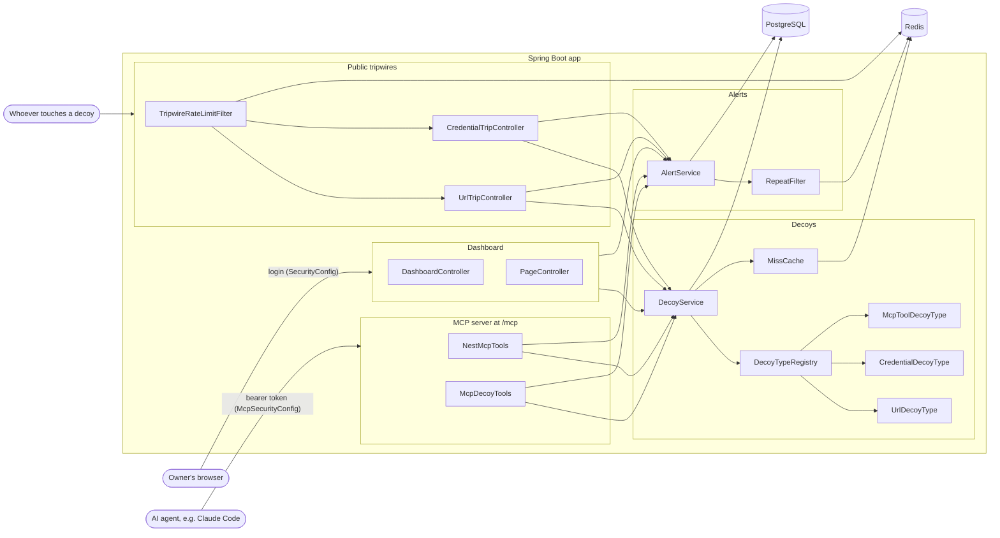
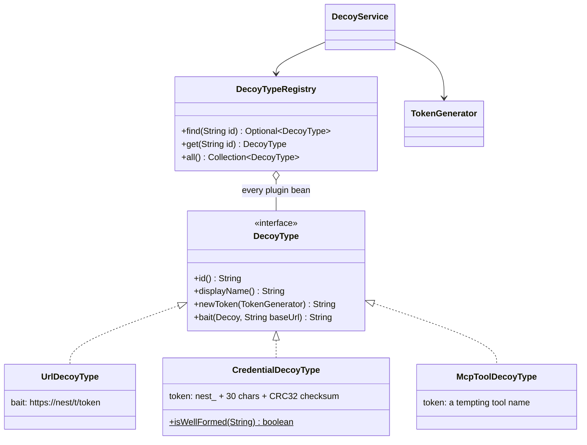
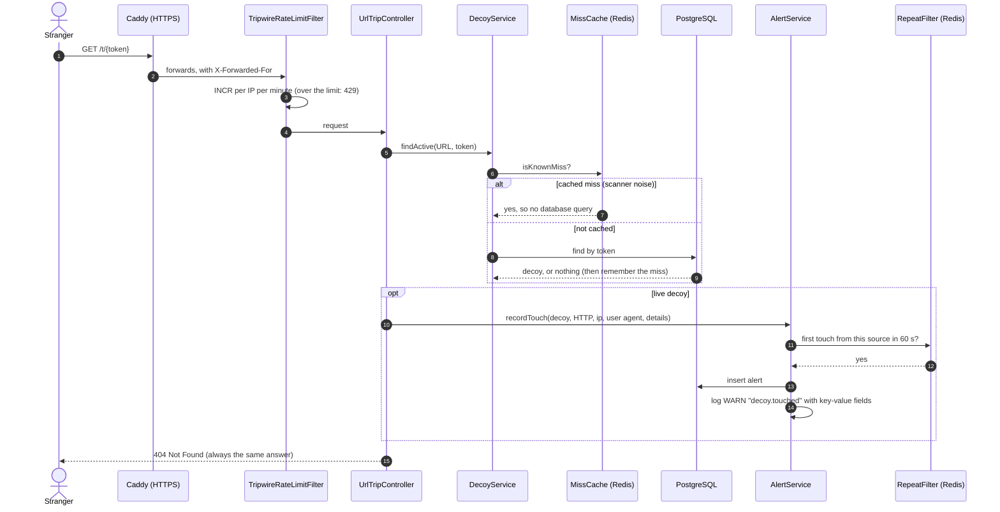
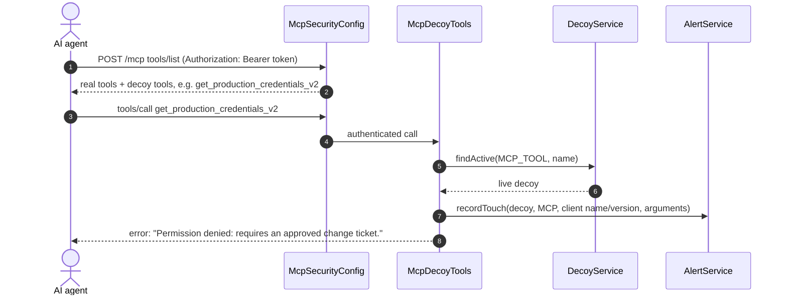
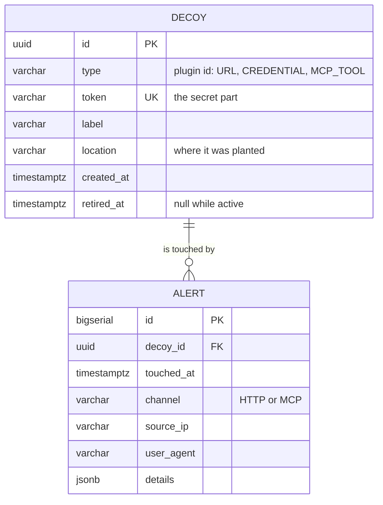
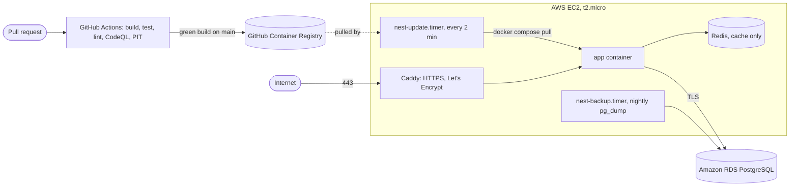

# Architecture

The Cuckoo's Nest is one Spring Boot application with three front doors: a dashboard for the
owner, an MCP endpoint for AI agents, and public tripwires for whoever touches a decoy. Every class
named on this page exists in `src/main/java`; `ArchitectureDocsTests` fails the build if one is
renamed or removed, so the diagrams can't quietly drift from the code.

Design decisions and their reasons are recorded in [`docs/adr`](adr/).

## Components

| Package | Responsibility |
|---|---|
| `decoy` | Decoys and the plugin system: `DecoyType`, `DecoyTypeRegistry`, `DecoyService`, `TokenGenerator`, `MissCache` |
| `decoy.types` | The three plugins: `UrlDecoyType`, `CredentialDecoyType`, `McpToolDecoyType` |
| `alert` | Recording touches: `AlertService`, `RepeatFilter`, `AlertRepository` |
| `trip` | Public tripwires: `UrlTripController`, `CredentialTripController`, `TripwireRateLimitFilter` |
| `mcp` | The MCP server: `NestMcpTools` (real tools) and `McpDecoyTools` (decoy tools) |
| `web` | The dashboard: `DashboardController`, `PageController` |
| `config` | Security, settings, i18n: `SecurityConfig`, `McpSecurityConfig`, `AdminUserConfig`, `NestProperties`, `WebConfig` |

## The plugin system

A new kind of decoy is one class that implements `DecoyType`. `DecoyTypeRegistry` collects every
plugin bean at startup, so nothing else changes (see [ADR 2](adr/0002-decoys-are-plugins.md)).

## A URL decoy is touched

## An AI agent calls a decoy tool

When a decoy tool is created or retired, `DecoyService` publishes a `DecoyEvent`, and
`McpDecoyTools` adds or removes the tool on the live MCP server after the database commit.

## Data model

Flyway owns the schema (`src/main/resources/db/migration`); Hibernate only validates that the
entities match it ([ADR 5](adr/0005-flyway-owns-the-schema.md)).

## Deployment

The server pulls new images; GitHub never pushes into it
([ADR 8](adr/0008-pull-based-continuous-deployment.md)). Details: [deploy/README.md](../deploy/README.md).
